# The Olympic Rings

**Five rings drawn in Python, and the story of the Summer Olympic Games behind them, from Athens 1896 to Paris 2024.**

<p align="center">
  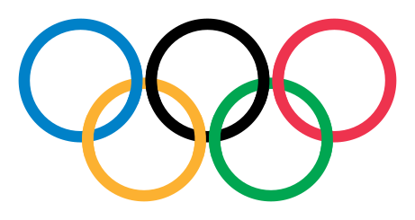
</p>

This repo began in 2024 as a small Matplotlib exercise while I was learning Python. The rings are still here, now
properly interlocked. Around them is every Summer Games on record, who hosted it, who won the most and how the sports
have changed, with every figure traced to a named source.

> 📈 **Charts are drawn with [bezel-charts](https://pypi.org/project/bezel-charts/), my open-source Python library.**
> It turns pandas data into clean, self-contained SVG charts. This project uses all ten of its chart types.
> `pip install bezel-charts` · [PyPI](https://pypi.org/project/bezel-charts/) ·
> [GitHub](https://github.com/ShazMoghaddam/bezel-charts)

<p align="center">
  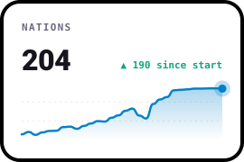
  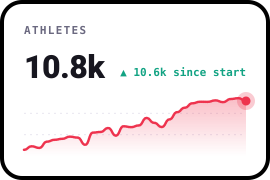
  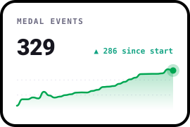
</p>

## Contents

[How it started](#how-it-started) · [How the Games grew](#how-the-games-grew) · [Who has hosted](#who-has-hosted) ·
[Who has won the most](#who-has-won-the-most) · [How the sports changed](#how-the-sports-changed) ·
[Every Games](#every-games) · [Data sources](#data-sources) · [Run it yourself](#run-it-yourself)

---

## How it started

**The ancient Games.** The earliest written records of athletic contests at Olympia, in Greece, date from 776 BC. The
Games were held every four years in honour of Zeus and lasted for more than a thousand years, until the Roman emperor
Theodosius I abolished them in 393 AD.

**The revival.** On 23 June 1894, in Paris, Pierre de Coubertin's campaign to bring the Games back led to the creation
of what became the International Olympic Committee. Two years later, in April 1896, Athens staged the first modern
Games: 241 men from 14 nations, in 9 sports and 43 events. There were no gold medals. Winners received silver. The
first champion of the modern era was James Connolly, in the triple jump.

**The early years.** Paris 1900 and St. Louis 1904 were folded into a world exhibition and a world fair and each
dragged on for months. Paris was also where women first competed, 22 of them, in sports including tennis and golf.
Stockholm 1912 was the first Games with competitors from all five continents.

**The rings.** Coubertin drew the symbol by hand at the top of a letter in 1913. Writing in the Olympic Review that
August, he said the rings "represent the five parts of the world now won over to Olympism". The war delayed their
Olympic debut until Antwerp 1920, which also brought the first athletes' oath.

**War and politics.** The Games of 1916, 1940 and 1944 were cancelled because of the two world wars. In Munich in 1972,
competition stopped for 34 hours after 11 members of the Israeli team were killed. Boycotts then hit three Games in a
row: Montreal 1976, over New Zealand's rugby tour of apartheid South Africa, then the US-led boycott of Moscow 1980
and the Soviet-led boycott of Los Angeles 1984.

**The modern Games.** Tokyo 1964 was the first in Asia, Mexico City 1968 the first in Latin America and Rio 2016 the
first in South America. In 1996 every recognised National Olympic Committee took part for the first time. Tokyo 2020
was held in 2021 because of the pandemic. At Paris 2024, 49% of the athletes were women.

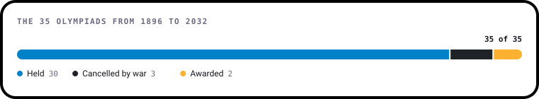

---

## How the Games grew

The first Games had 241 athletes. Every Games since Atlanta 1996 has had more than 10,000, and the number has levelled
off even as new events keep arriving.

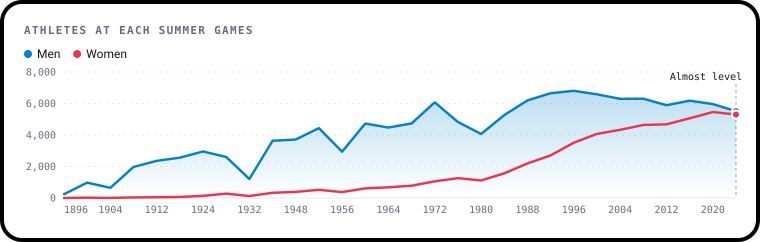

**Women went from a footnote to almost half.** They were 2.2% of athletes in 1900, 13.2% in 1964 and 34.0% in 1996.

<p align="center">
  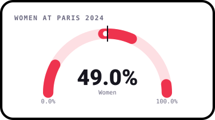
</p>

**Boycotts show up clearly.** Nations fell from 121 in 1972 to 92 in 1976 and 80 in 1980, then jumped to a record 140
in 1984 despite the Soviet-led boycott.

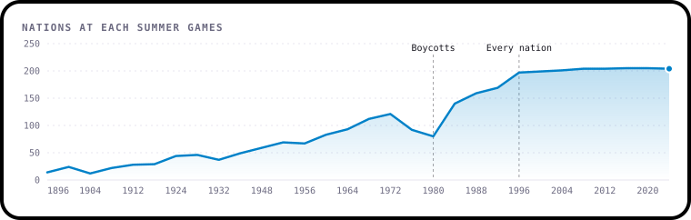

Nations and athletes have risen almost in step, with a very strong correlation across all 30 Games. Moscow 1980 is
one of the points where politics pulled both down at once.

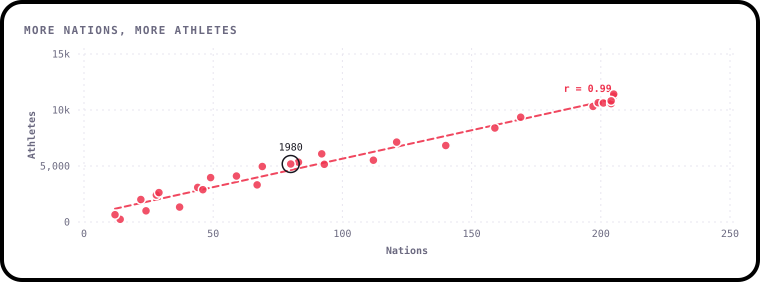

---

## Who has hosted

Of the 30 Summer Games so far, Europe has hosted more than half. **No Summer Games has ever been held in Africa.** Los
Angeles 2028 and Brisbane 2032 will bring the Americas to 8 and Oceania to 3.

<p align="center">
  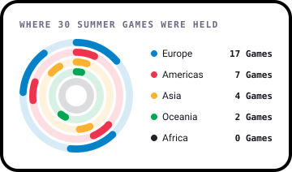
  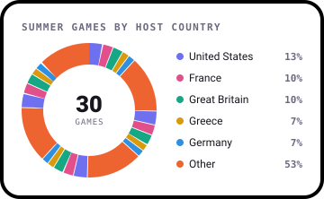
</p>

The United States has hosted the most, with four Games. France and Great Britain have hosted three each.

**August is Olympic month.** This calendar lays all 30 Games over one year, and the darker the square, the more Games
have been running on that date. The peak is 1 August, at 17 Games. The long, pale stretches come from the early Games,
which lasted for months: London 1908 ran from April to October. The December squares are Melbourne 1956,
held in the southern summer. Weekdays don't mean anything here, as these dates span 128 years.

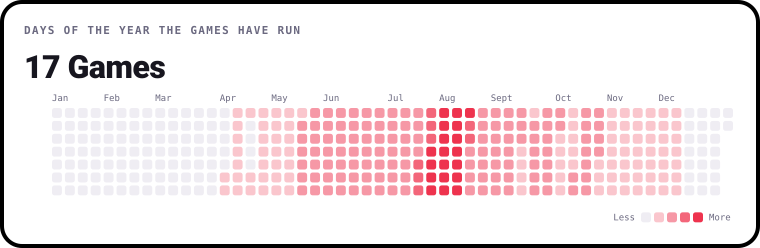

---

## Who has won the most

The United States is far ahead on every count, with 2,765 Summer medals. The Soviet Union is second with 1,010, even
though it competed at only nine Games.

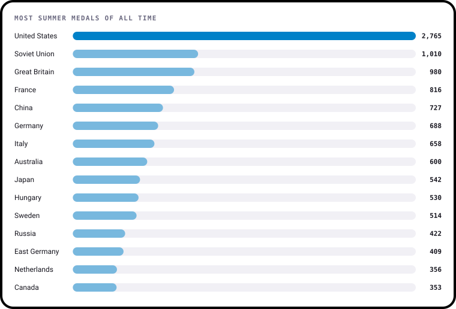

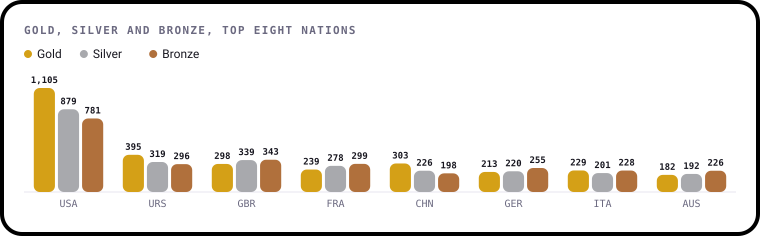

Ranking by gold changes the order. China had only 12 Summer Games behind it by 2024, yet ranks third with 303 golds,
ahead of Great Britain, which has been at all 30.

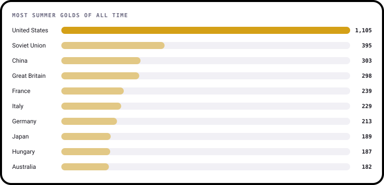

**Read these with care:**

- These tables are for interest only. The Olympic Charter says the IOC "shall not draw up any global ranking per
  country", and the Games are officially between athletes, not countries.
- Teams are kept as they competed, so the Soviet Union and Russia are separate, as are Germany, East Germany and West
  Germany. Adding any of them together would change the order.
- Different sources give slightly different totals, mainly because of the early Games and medals reallocated after
  doping cases. These figures include changes up to 11 August 2024.

---

## How the sports changed

Five sports have been at all 30 Summer Games: aquatics, athletics, cycling, fencing and gymnastics. Others have come
and gone. Golf returned in 2016 after 112 years away, and so did rugby after 92. Cricket, croquet, polo and tug of war
have all been Olympic sports. Each row below is a sport, in the order it first appeared.

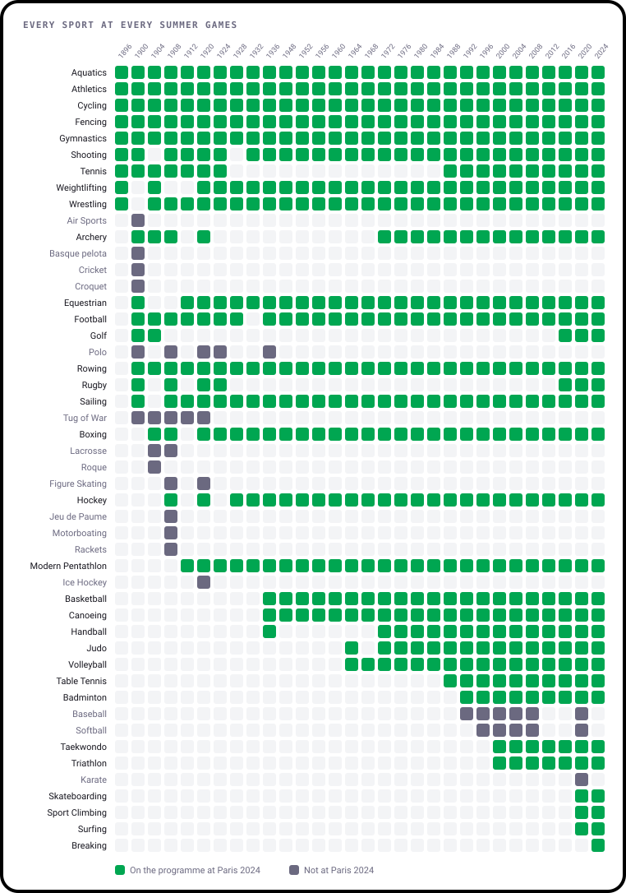

The programme has grown most since the 1980s, reaching 33 sports at Tokyo 2020. Los Angeles 2028 will have 36, adding
baseball and softball, cricket, flag football, lacrosse and squash for those Games only.

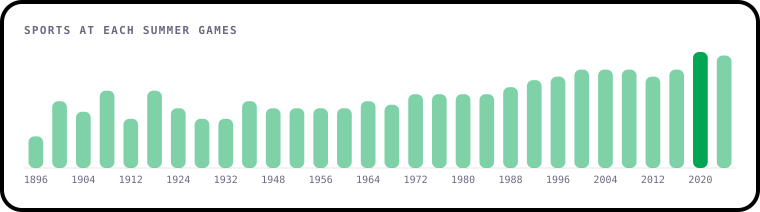

Athletics and aquatics have handed out far more medals than anything else.

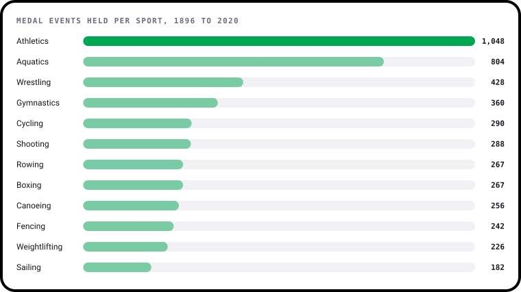

Where one nation is clearly ahead in a sport, it's usually the one you'd guess:

<!-- leaders:start -->
| Sport | Medal events, 1896 to 2020 | Most medals |
| --- | ---: | --- |
| Athletics | 1,048 | United States |
| Aquatics | 804 | United States |
| Wrestling | 428 | United States |
| Gymnastics | 360 | Soviet Union |
| Shooting | 288 | United States |
| Rowing | 267 | United States |
| Boxing | 267 | United States |
| Judo | 152 | Japan |
| Archery | 71 | South Korea |
| Taekwondo | 48 | South Korea |
| Badminton | 39 | China |
| Table Tennis | 37 | China |
| Hockey | 35 | Netherlands |
<!-- leaders:end -->

*Counted from Olympedia's results up to Tokyo 2020, for sports with at least 35 medal events and a leader at least a
fifth clear of second place.*

---

## Every Games

<!-- games:start -->
| Year | City | Host | Continent | Nations | Athletes | Women | Sports | Events |
| --- | --- | --- | --- | ---: | ---: | ---: | ---: | ---: |
| 1896 | Athens | Greece | Europe | 14 | 241 | 0.0% | 9 | 43 |
| 1900 | Paris | France | Europe | 24 | 997 | 2.2% | 19 | 95 |
| 1904 | St. Louis | United States | Americas | 12 | 651 | 0.9% | 16 | 95 |
| 1908 | London | Great Britain | Europe | 22 | 2,008 | 1.8% | 22 | 110 |
| 1912 | Stockholm | Sweden | Europe | 28 | 2,407 | 2.0% | 14 | 102 |
| 1916 | *Cancelled because of the First World War* | | | | | | | |
| 1920 | Antwerp | Belgium | Europe | 29 | 2,626 | 2.5% | 22 | 156 |
| 1924 | Paris | France | Europe | 44 | 3,089 | 4.4% | 17 | 126 |
| 1928 | Amsterdam | Netherlands | Europe | 46 | 2,883 | 9.6% | 14 | 109 |
| 1932 | Los Angeles | United States | Americas | 37 | 1,332 | 9.5% | 14 | 117 |
| 1936 | Berlin | Germany | Europe | 49 | 3,963 | 8.4% | 19 | 129 |
| 1940 | *Cancelled because of the Second World War* | | | | | | | |
| 1944 | *Cancelled because of the Second World War* | | | | | | | |
| 1948 | London | Great Britain | Europe | 59 | 4,104 | 9.5% | 17 | 136 |
| 1952 | Helsinki | Finland | Europe | 69 | 4,955 | 10.5% | 17 | 149 |
| 1956 | Melbourne | Australia | Oceania | 67 | 3,314 | 11.3% | 17 | 151 |
| 1960 | Rome | Italy | Europe | 83 | 5,338 | 11.4% | 17 | 150 |
| 1964 | Tokyo | Japan | Asia | 93 | 5,151 | 13.2% | 19 | 163 |
| 1968 | Mexico City | Mexico | Americas | 112 | 5,516 | 14.2% | 18 | 172 |
| 1972 | Munich | Germany | Europe | 121 | 7,134 | 14.8% | 21 | 195 |
| 1976 | Montreal | Canada | Americas | 92 | 6,084 | 20.7% | 21 | 198 |
| 1980 | Moscow | Soviet Union | Europe | 80 | 5,179 | 21.5% | 21 | 203 |
| 1984 | Los Angeles | United States | Americas | 140 | 6,829 | 22.9% | 21 | 221 |
| 1988 | Seoul | South Korea | Asia | 159 | 8,391 | 26.1% | 23 | 237 |
| 1992 | Barcelona | Spain | Europe | 169 | 9,356 | 28.9% | 25 | 257 |
| 1996 | Atlanta | United States | Americas | 197 | 10,318 | 34.0% | 26 | 271 |
| 2000 | Sydney | Australia | Oceania | 199 | 10,651 | 38.2% | 28 | 300 |
| 2004 | Athens | Greece | Europe | 201 | 10,625 | 40.7% | 28 | 301 |
| 2008 | Beijing | China | Asia | 204 | 10,942 | 42.4% | 28 | 302 |
| 2012 | London | Great Britain | Europe | 204 | 10,568 | 44.2% | 26 | 302 |
| 2016 | Rio de Janeiro | Brazil | Americas | 205 | 11,238 | 45.0% | 28 | 306 |
| 2020 | Tokyo | Japan | Asia | 205 | 11,420 | 47.8% | 33 | 339 |
| 2024 | Paris | France | Europe | 204 | 10,813 | 49.0% | 32 | 329 |
| 2028 *(awarded)* | Los Angeles | United States | Americas |  |  |  | 36 | 353 |
| 2032 *(awarded)* | Brisbane | Australia | Oceania |  |  |  |  |  |
<!-- games:end -->

*Nations are National Olympic Committees as counted by the IOC, so they leave out the Refugee Olympic Team and neutral
athletes. Melbourne 1956 athletes and events include the equestrian events held in Stockholm. Sports for 2028 and later
are the planned programme. Germany in 1972 was West Germany.*

---

## Data sources

| What | Source | File |
| --- | --- | --- |
| Hosts, dates, nations, athletes, events | IOC, [The Games of the Olympiad](https://stillmed.olympics.com/media/Documents/Olympic-Games/Factsheets/The-Games-of-the-Olympiad.pdf) factsheet, updated 30 March 2026 | [`games.csv`](data/games.csv) |
| Women, men, sports, events per Games, sports added | IOC, [The programme of the Games of the Olympiad](https://stillmed.olympics.com/media/Documents/Olympic-Games/Factsheets/The-programme-of-the-Games-of-the-Olympiad.pdf) factsheet, updated 12 August 2026 | [`games.csv`](data/games.csv) |
| Sport by sport, 1896 to 2020 | [Olympedia](https://www.olympedia.org/), the database built by Olympic historians, collected in [Olympics-Dataset](https://github.com/KeithGalli/Olympics-Dataset) | [`sports_programme.csv`](data/sports_programme.csv), [`sport_events.csv`](data/sport_events.csv) |
| All-time medal table, up to Paris 2024 | [Wikipedia, Olympics medal table](https://en.wikipedia.org/wiki/Olympics_medal_table) (the IOC publishes tallies per Games, not an all-time table) | [`medals_all_time.csv`](data/medals_all_time.csv) |
| Ancient Games, 1894, 1896 | IOC, The Olympic Museum, [How well do you know the Olympic Games?](https://stillmed.olympics.com/media/Document%20Library/Museum/Visit/TOM-Schools/Teaching-Resources/Do-you-know-the-Olympic-Games/Do-you-know-the-Olympic-Games-EN.pdf) | |
| The rings | IOC, [Who created the Olympic rings symbol?](https://www.olympics.com/ioc/faq/olympic-symbol-and-identity/who-created-the-olympic-rings-symbol) and [First public presentation of the five rings](https://www.olympics.com/ioc/1913-first-public-presentation-of-the-five-rings-symbol) | |

Where the sources differ, the IOC's own figure is used. For example, the IOC counts 24 nations in 1900 and some other
lists count 25. [`data/sources.json`](data/sources.json) lists every source with what it was used for, and the
[tests](tests/test_data.py) check the data against the IOC's totals.

Continents and the charts' calculations are my own, using the five continents of the Olympic symbol, with North and
South America together as the Americas. Winter Games aren't included.

*This is an independent educational project, not connected with or endorsed by the International Olympic Committee. The
Olympic rings are a protected symbol of the IOC, and they're drawn here for learning and illustration only.*

---

## Run it yourself

```sh
git clone https://github.com/ShazMoghaddam/OlympicRings.git
cd OlympicRings
pip install -r requirements.txt

python main.py          # draw the rings
python build_charts.py  # redraw every chart and the README tables
pytest                  # check the data
```

`data/build_sports.py` rebuilds the sports files from the Olympedia data, a 33 MB download. You only need it to change
how the sports are counted.

### How the rings work

The first version stacked five circles, so one ring always sat fully on top of the next. Linked rings have to go over a
neighbour at one crossing and under it at the other. [`main.py`](main.py) draws each ring, works out where neighbouring
rings cross, then paints a short arc of the top ring back over each crossing.

---

## Licence

[MIT](LICENSE).

---

Created by **Shaz Moghaddam** · London
[Website](https://shazmoghaddam.github.io) · [LinkedIn](https://www.linkedin.com/in/shazmoghaddam)
